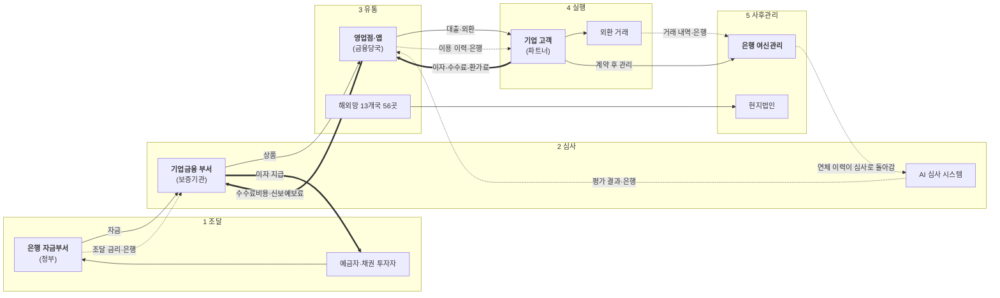

# IBK기업은행 밸류체인 v0 (AI 초안)

검증 전 초안입니다. 검증 결과는 [analysis.md](analysis.md), 확정본은 [valuechain_v1.md](valuechain_v1.md)에 있습니다.

## 단계별 근거

| 단계 | 원페이지 칸 | 근거 |
|---|---|---|
| 1 조달 | B 재무·비용 일부 | [출처 1 p.16], [출처 52 II-5] |
| 2 심사 | 없음 | [출처 6], [출처 22] |
| 3 유통 | A 어떻게 전달 | [출처 21 p.051·p.074] |
| 4 실행 | A 무엇을, 무엇으로 | [출처 1 p.10], [출처 21 p.073] |
| 5 사후관리 | D 산업 이슈 | [출처 1 p.18·p.19] |
