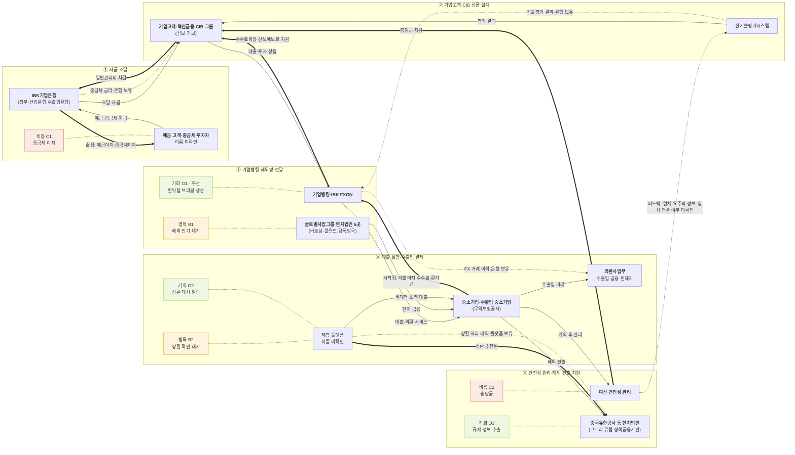

# IBK기업은행 밸류체인 맵 v1

- 범위: 기업금융, 외환, 글로벌
- 입력: [원페이지](../research/company/ibk기업은행/외환글로벌기업금융/onepager.md)
- 근거: [analysis.md](analysis.md)
- 상태: AI가 원페이지와 대조해 고친 판입니다. 팀 토론과 팀 결정은 아직 없습니다.
- 그림 범례: 실선은 상품·활동, 굵은 선은 돈, 점선은 데이터입니다. 주황은 병목, 코랄은 비용, 라임은 기회입니다.
- 팀 자산: 자료가 저장소에 없어 틸 색 칸이 없습니다 [U].

## 단계별 네 층

| 단계 | 활동 | 이해관계자 | 돈 흐름 | 데이터 이름 · 생성 지점 · 보유자 | 근거 |
|---|---|---|---|---|---|
| ① 자금 조달 | 예금과 중금채로 자금을 모음 | **IBK기업은행**, **예금 고객·중금채 투자자 [U]**, (정부·산업은행·수출입은행) | 끝점: 예금이자·중금채이자 | 중금채 금리 · 창구·시장 조달 · 은행 | [출처 1 p.10·p.16], [출처 21 p.030] |
| ② 기업고객·CIB 상품 설계 | 대출·투자 상품을 설계하고 평가함 | **기업고객·혁신금융·CIB 그룹**, (신보·기보) | 일반관리비 차감 | 기술평가 결과 · 신기술평가시스템 · 은행 | [출처 22], [출처 36], [출처 1 p.9], [출처 6] |
| ③ 기업뱅킹·해외망 전달 | 온라인과 현지법인으로 서비스를 전달함 | **기업뱅킹·IBK FXON**, **글로벌사업그룹·현지법인**, (베트남·폴란드 감독당국) | 수수료비용·신보예보료 차감 | FX 거래 이력 · IBK FXON · 은행 | [출처 21 p.051·p.073], [출처 1 p.11·p.12], [출처 26], [출처 28] |
| ④ 대출 실행·수출입 결제 | 대출 실행, 수출입 금융, 환헤지를 처리함 | **중소기업·수출입 중소기업**, **외환사업부**, (무역보험공사), (제휴 플랫폼 [U]) | 시작점: 대출이자·수수료·환가료 | 상환 처리 내역 · 제휴 플랫폼 · 플랫폼 [I] | [출처 1 p.10·p.14], [출처 22], [출처 23] (메뉴명), [출처 29], [출처 43] (기사) |
| ⑤ 건전성 관리·해외 진출 지원 | 연체와 충당금을 관리하고 해외 정보를 제공함 | **여신 건전성 관리**, **현지법인**, (코트라·유럽 정책금융기관) | 충당금 차감 | 연체·요주의 정보 · 여신 관리 · 은행 | [출처 1 p.9·p.18·p.19], [출처 21 p.074], [출처 29], [출처 31] |

## 돈 흐름 메모

맵에는 금액을 넣지 않았습니다. 아래는 출처가 있는 수치만 적은 메모입니다.

| 항목 | 값 | 범위 | 근거 |
|---|---:|---|---|
| 대출금이자 | 9,914.9십억원 | 별도, 3Q26 누적, 가계 포함 | [출처 1 p.10] |
| 수수료수익 | 477.6십억원 | 별도, 3Q26 누적 | [출처 1 p.11] |
| 중금채이자 등 | 5,439.9십억원 | 별도, 3Q26 누적 | [출처 1 p.10] |
| 일반관리비 | 2,271.1십억원 | 별도, 3Q26 누적 | [출처 1 p.9] |
| 제충당금순전입액 | 1,359.0십억원 | 별도, 3Q26 누적 | [출처 1 p.9] |

- **본류와 분리할 흐름:** 외환파생관련손익은 고객 결제 흐름에 넣지 않았습니다 [I] (근거: 출처 1 p.11, 회사 공식 구성 내역 미확인).
- **끝점의 나머지:** 비용을 뺀 이익이 주주에게 얼마나 가는지는 자료에 없습니다 [U].

## 표기 근거

- 돈 화살표는 고객에서 조달원 방향입니다 [I].
- 수수료비용과 신보예보료는 IR Book의 비이자이익 기타 각주에 있습니다 [출처 1 p.11].
- 연체 정보가 심사로 되돌아가는지는 자료로 확인하지 못했습니다 [U].
